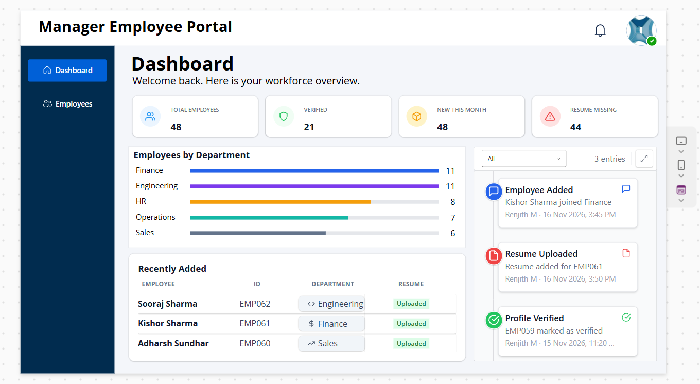
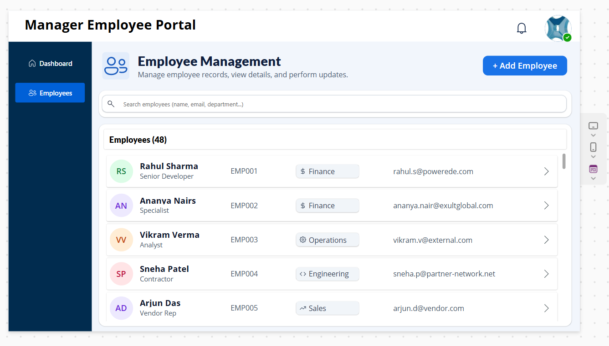
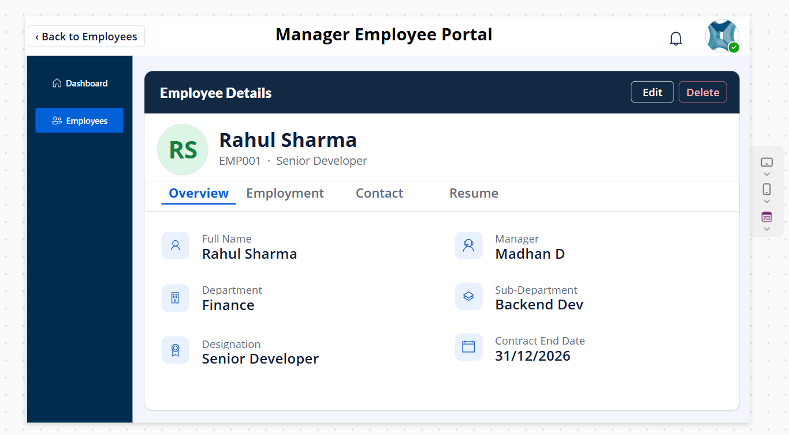
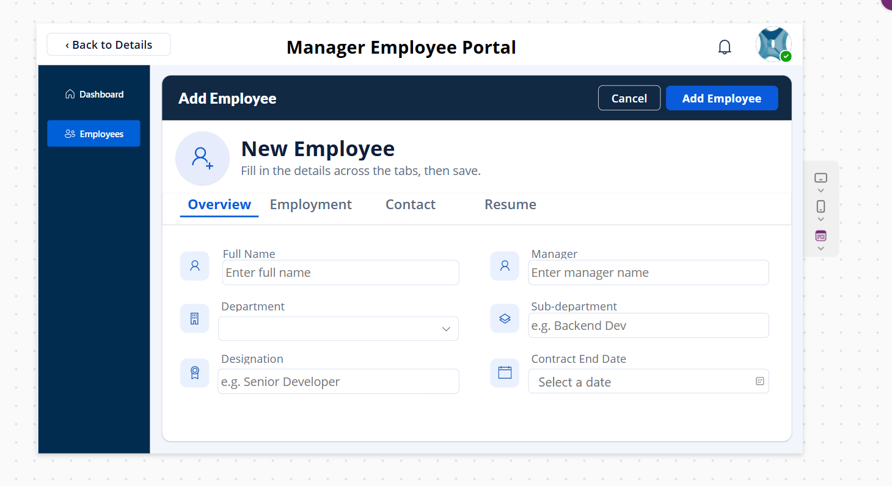

# Manager Employee Portal

A Power Apps canvas app that lets managers create and manage employee records in an organization. Employee data is stored in SharePoint lists, and a Power Automate flow uploads each employee's resume to a SharePoint document library.

> This repository is a project showcase. It contains screenshots and documentation of the app. The Power Apps and Power Automate source files are not included.

## Features

- **Dashboard:** KPI cards (total employees, verified profiles, new this month, resumes missing), headcount by department, recently added employees and a recent-activity feed.
- **Employee management:** view the employee list and search by name, email or department.
- **Full CRUD:** add, view, edit and delete employee records.
- **Tabbed employee profile:** Overview, Employment, Contact and Resume tabs.
- **Resume automation:** a Power Automate flow uploads resumes to a SharePoint document library and tracks each employee's resume status (Uploaded / Missing).
- **Delegation-friendly queries:** required filters are applied to data queries so the app stays fast and accurate as the employee list grows.

## Tech Stack

| Layer | Technology |
|---|---|
| Front end | Power Apps (Canvas App) |
| Automation | Power Automate (Cloud Flow) |
| Database | SharePoint Lists |
| File storage | SharePoint Document Library |

## Screenshots

### Dashboard

### Employee list

### Employee details

### Add employee

## How It Works

1. A manager adds an employee in the app and uploads a resume.
2. The Power Automate flow saves the file to the SharePoint document library.
3. The employee's resume status is updated.
4. The dashboard reflects the new employee count, resume status and recent activity.

## SharePoint Practices Used

- Appropriate column types (choice, date, person) instead of plain text
- Indexed columns for faster filtering and delegation support
- A unique employee ID to identify each record reliably

## Employee Record Fields

Employee ID, Full Name, Department, Sub-Department, Designation, Manager, Contract End Date, Resume Status

## What I Learned

- Building multi-screen canvas apps with navigation and tabbed forms
- Handling Power Apps delegation limits with delegable filters
- Designing SharePoint lists with proper column types and indexing
- Automating file uploads with Power Automate

## Author

**Renjith M**
[LinkedIn](https://linkedin.com/in/renjith-m) | [GitHub](https://github.com/renju1)
